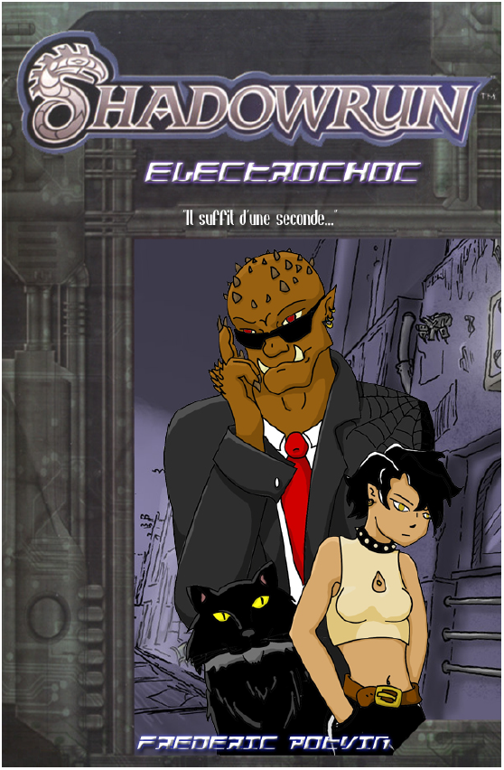

# Shadowrun : Électrochoc

À Seattle en 2063, dans un monde où la magie est revenue et où la technologie peut tuer en une seconde, Sara lutte pour survivre. Quand des événements qu’elle ne maîtrise pas bouleversent sa vie, elle découvre à son tour cette force mystique et doit s’aventurer dans les ombres pour s’en sortir.

[Quatrième de couverture](back-cover.png)

[Droits et crédits](NOTICE.md)

[← Tous les livres](../README.md)
