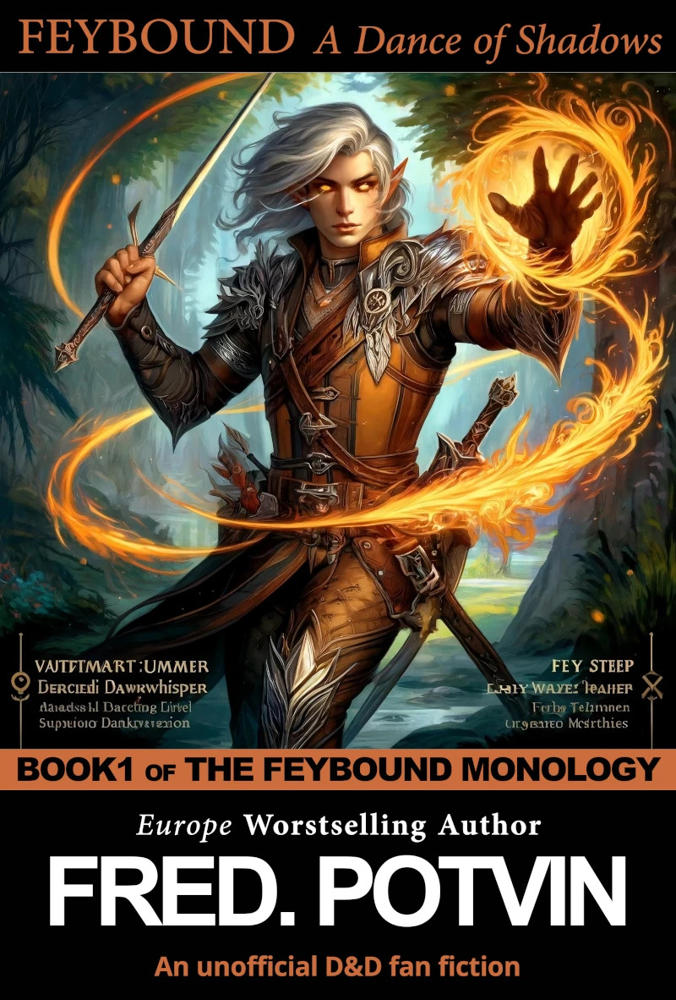

# Feybound: A Dance of Shadows

Marked by the Shadow Lord, the eladrin ranger Cecil struggles with a darkness that reveals truths he would rather leave hidden. Joined by Elara Brightmoon, a priestess torn between duty and love, and Arken, a sorcerer who can bend time, he travels through the Feywild to restore the balance the Shadow Lord threatens to undo.

[Lire en français](../fr/README.md)

[Rights and credits](../NOTICE.md)

[← All books](../../README.md)
