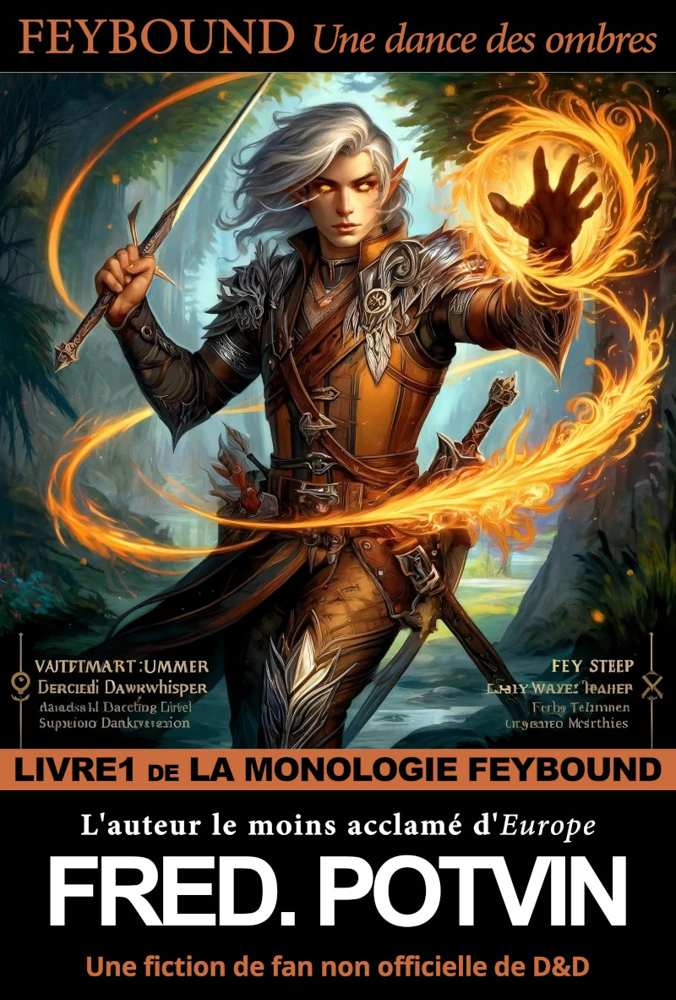

# Feybound : Une danse des ombres

Marqué par le Seigneur des Ombres, Cecil, un rôdeur éladrin, lutte contre des ténèbres qui lui révèlent des vérités qu’il préférerait ignorer. Avec Élara Clairlune, une prêtresse partagée entre son devoir et son amour pour lui, et Arken, un sorcier capable de plier le temps, il traverse les landes féériques pour rétablir l’équilibre menacé.

[Read in English](../en/README.md)

[Droits et crédits](../NOTICE.md)

[← Tous les livres](../../README.md)
