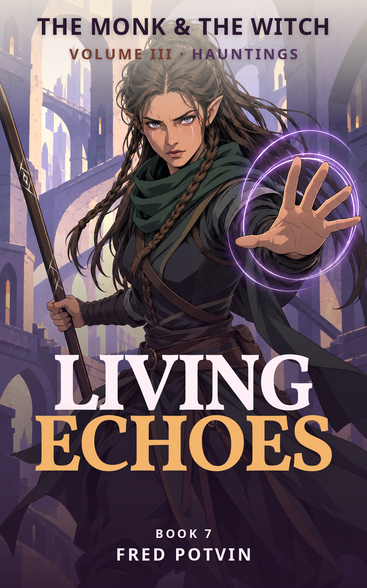

# Living Echoes

A broken wand gives Rishi, Maeril, and Grim one passage into Sigil to find Elisa and Chime. Someone who understands Maeril’s wardcraft keeps turning her search toward empty rooms, and the rescue may open a route an old enemy has been waiting for.

*The Monk & The Witch · Book 7 · Dungeons & Dragons fanfiction*

[Lire en français](../../fr/07-living-echoes/README.md)

[Rights and credits](../../NOTICE.md)

[← All books](../../../README.md)
