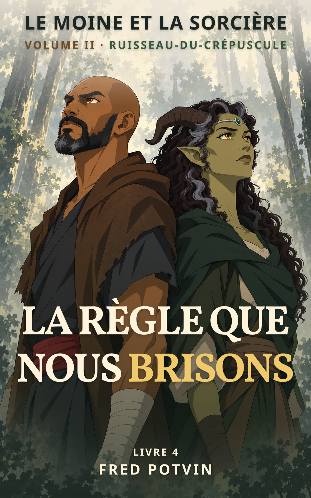

# La règle que nous brisons

Après le sang versé dans le bois sacré, la famille Clairelune offre un refuge à Rishi et Maeril, qui doivent gagner la confiance de leurs hôtes. Lorsqu’une enfant disparaît pendant la Fête de la Lune, ils suivent les traces d’une fracture dans la magie ancienne du Wealdath.

*Le Moine et la Sorcière · Livre 4 · Fanfiction Dungeons & Dragons*

[Read in English](../../en/04-the-rule-we-break/README.md)

[Droits et crédits](../../NOTICE.md#français)

[← Tous les livres](../../../README.md)
