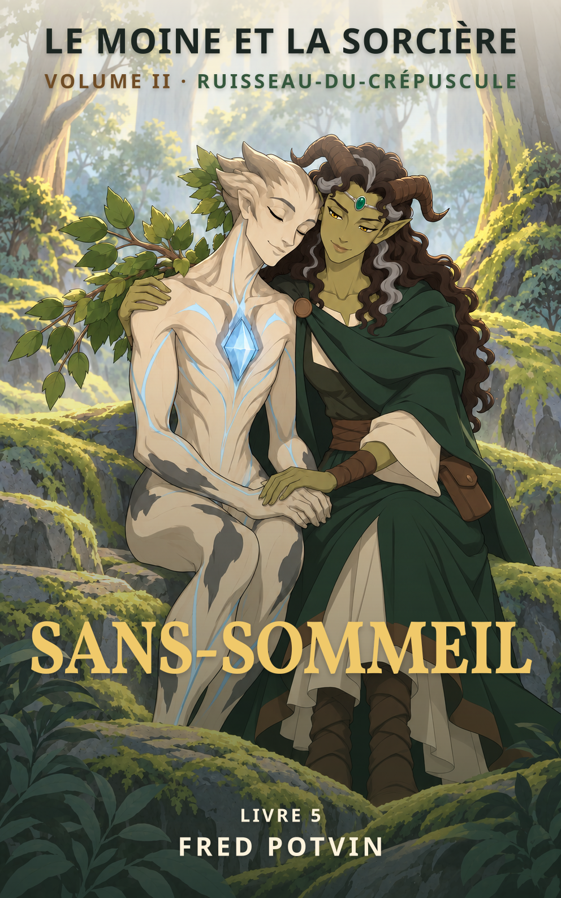

# Sans-Sommeil

Rishi et Maeril réveillent Syltrame, un gardien ancestral qui apprend auprès d’eux à parler, à faire confiance et à trouver sa place. Quand une neige de cendre tombe sur le Wealdath, leurs recherches les mènent à une machine enfouie dont les défenses corrompues menacent leur nouvelle famille.

*Le Moine et la Sorcière · Livre 5 · Fanfiction Dungeons & Dragons*

[Read in English](../../en/05-the-sleepless-one/README.md)

[Droits et crédits](../../NOTICE.md#français)

[← Tous les livres](../../../README.md)
