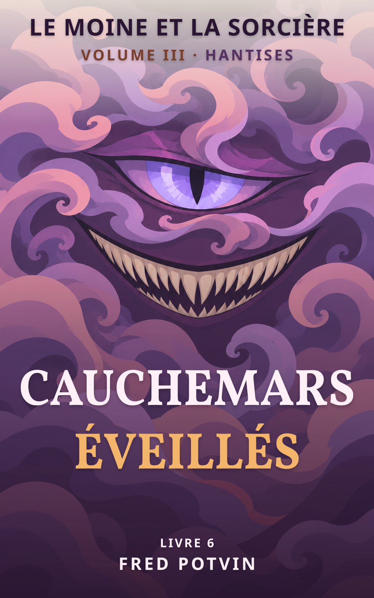

# Cauchemars éveillés

Le retour de Braisâme ramène Rishi, Maeril et Elisa à Eauprofonde, où Manshoon et Xanathar convoitent la Pierre de Golorr. Tandis que les cauchemars de Xanathar prennent corps, ils doivent trouver la Pierre avant que l’un des rivaux n’atteigne la cache du dragon et que la ville ne s’effondre.

*Le Moine et la Sorcière · Livre 6 · Fanfiction Dungeons & Dragons*

[Read in English](../../en/06-waking-nightmares/README.md)

[Droits et crédits](../../NOTICE.md#français)

[← Tous les livres](../../../README.md)
