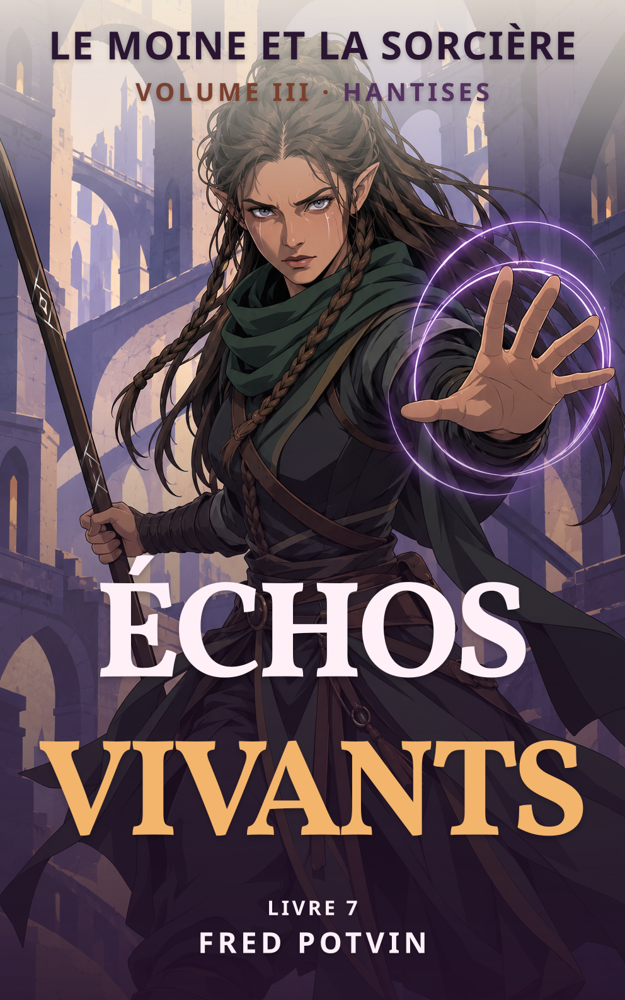

# Échos vivants

Une baguette brisée offre à Rishi, à Maeril et à Grim un passage sans retour vers Sigil, où ils espèrent retrouver Elisa et Tintelle. Quelqu’un qui connaît les protections de Maeril de l’intérieur détourne ses recherches, et le sauvetage risque de rouvrir un chemin qu’un vieil ennemi attend de pouvoir emprunter.

*Le Moine et la Sorcière · Livre 7 · Fanfiction Dungeons & Dragons*

[Read in English](../../en/07-living-echoes/README.md)

[Droits et crédits](../../NOTICE.md#français)

[← Tous les livres](../../../README.md)
